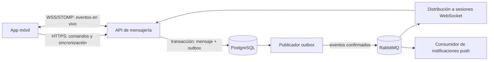

# Propuesta: microservicio de mensajería para app móvil

## Objetivo y alcance

Convertir este repositorio en el servicio responsable de conversaciones, miembros, mensajes, estado de lectura y entrega en tiempo real. La app móvil se conecta al servicio por HTTPS y WebSocket/STOMP. RabbitMQ comunica instancias y consumidores internos; la app no se conecta directamente a RabbitMQ. PostgreSQL conserva el historial y permite recuperar lo ocurrido durante una desconexión.

El primer alcance es mensajería directa de texto. Grupos, adjuntos, búsqueda, presencia y cifrado de extremo a extremo quedan como decisiones posteriores, porque cambian el modelo y el contrato público.

## Diagnóstico inicial (histórico, anterior a los PRs #1–#5)

| Prioridad | Hallazgo en el código | Consecuencia |
| --- | --- | --- |
| P0 | `Security/Config/AuthConfig.java` permite todas las solicitudes; no hay un filtro HTTP que establezca la identidad desde el JWT. | Las rutas de chat y usuarios no tienen protección efectiva. |
| P0 | `MessageDTO` acepta `sender`, y `WebSocketController` guarda ese DTO sin derivar el remitente del usuario autenticado. | Un cliente puede intentar suplantar al remitente. |
| P0 | `MessageController` publica `chat.message`, `chat.edit` y `chat.delete`, pero `RabbitMQConfig` solo vincula `chat.default` a la cola fija. No hay consumidores de edición o borrado. | Las peticiones REST pueden responder `202` sin aplicar la operación. |
| P0 | Las consultas de historial y no leídos no comprueban membresía; `markAsRead` tampoco comprueba que el mensaje pertenezca al chat solicitado. | Posible acceso o modificación de datos de otros chats. |
| P1 | REST envía a AMQP y WebSocket escribe directamente en la base de datos. | Dos caminos con validaciones y garantías distintas. |
| P1 | `UserDTO` contiene `password` y se usa en respuestas y dentro de `MessageDTO`. | Riesgo de exponer el hash y datos personales innecesarios. |
| P1 | `ChatRepository.findDirectChat` compara `ChatMember.id` con IDs de usuario. | Puede no encontrar un chat existente y crear duplicados. |
| P1 | `application.properties` usa puerto `8001`; Compose y Dockerfile publican `8000`. Compose también conserva servicios y rutas ajenos al servicio. | El despliegue del microservicio es inconsistente. |

## Arquitectura objetivo



1. El servicio valida el token emitido por el proveedor de identidad de la aplicación y obtiene de él un **ID de usuario estable**. El ID del remitente nunca viene del cuerpo de la petición.
2. Toda escritura pasa por un único caso de uso (`SendMessage`, `EditMessage`, etc.) que valida membresía y permisos. REST y STOMP pueden invocarlo, pero comparten la misma lógica.
3. La creación del mensaje y de una fila `outbox` ocurre en una transacción. Una tarea publica el evento en RabbitMQ con confirmación; si falla, reintenta sin perder el mensaje ya guardado.
4. Cada consumidor es idempotente. RabbitMQ puede entregar un evento más de una vez; `eventId` y `messageId` permiten reconocer duplicados.
5. WebSocket entrega eventos en vivo. Tras reconectar, la app consulta PostgreSQL para recuperar mensajes faltantes; WebSocket no es el historial ni una confirmación de lectura.

### Límite del microservicio

Este servicio conserva `userId` y, si hace falta, un pequeño perfil público para mostrar nombres o fotos. No debe administrar contraseñas ni ser dueño de la tabla completa de usuarios de la aplicación. Si inicialmente se mantiene el módulo `User` existente, debe separarse `PublicUserDTO` y ocultarse siempre `password` antes de exponer la API. La integración final con el proveedor de identidad y de perfiles requiere definir sus contratos.

## Contrato mínimo para móvil

Usar DTO de entrada distintos de los DTO de salida. Las fechas se devuelven en UTC (ISO 8601). Todos los recursos privados comprueban membresía en el servidor.

| Operación | Contrato propuesto | Resultado |
| --- | --- | --- |
| Abrir DM | `POST /v1/conversations/direct` con `otherUserId` | Devuelve la conversación existente o creada; operación idempotente. |
| Listar conversaciones | `GET /v1/conversations?cursor=&limit=` | Lista ordenada por última actividad y cursor siguiente. |
| Enviar mensaje | `POST /v1/conversations/{id}/messages` con `clientMessageId`, `content` y `type` | `201` con `messageId`, `senderId`, `createdAt` y estado `SENT`; repetir el mismo ID devuelve el mismo mensaje. |
| Recuperar historial | `GET /v1/conversations/{id}/messages?before=&limit=` | Página por cursor estable, ordenada por `(createdAt, id)`. |
| Editar / borrar | `PATCH /v1/messages/{id}` / `DELETE /v1/messages/{id}` | Solo autor o política explícita de moderación; el borrado lógico preserva la referencia del evento. |
| Marcar leído | `PUT /v1/conversations/{id}/read-cursor` con `messageId` | Avanza el cursor de lectura del usuario de forma monotónica. |

Ejemplo de envío:

```json
{
  "clientMessageId": "a23bb862-078f-4b6b-9ef5-491cdb87d14f",
  "content": "Hola",
  "type": "TEXT"
}
```

La app genera `clientMessageId` antes de enviar. Si pierde la respuesta, puede repetir la petición sin crear otro mensaje. Para el primer alcance, `type` puede omitirse y fijarse como `TEXT` en el servidor.

### Tiempo real

- Conexión `WSS /dm` autenticada; validar token en `CONNECT` y rechazar conexiones anónimas.
- Suscripción a `/topic/conversations.{id}` solo para miembros; restringir también destinos `/queue` y cualquier `SEND` que no sea una ruta de aplicación permitida.
- Eventos versionados: `message.created`, `message.updated`, `message.deleted`, `conversation.read` y `typing.changed` (este último es efímero y no se persiste).
- Cada evento incluye `eventId`, `schemaVersion`, `conversationId`, `occurredAt` y los datos mínimos necesarios. La app ordena y deduplica por `messageId` y recupera faltantes por HTTP.
- Si se decide permitir envío por STOMP, `/app/conversations/{id}/send` invoca exactamente el mismo caso de uso que REST y devuelve una confirmación correlacionada con `clientMessageId`.

## RabbitMQ y persistencia

- Usar un exchange durable de eventos, por ejemplo `messaging.events`, con claves `message.created`, `message.updated`, `message.deleted` y `conversation.read`.
- Declarar colas durables por **consumidor**, no una cola durable por chat: `messaging.realtime`, `messaging.push`, más sus colas de errores. Las colas de consumidores distintos reciben cada evento que necesiten; las instancias de un mismo consumidor compiten dentro de su cola.
- Para repartir el evento a las sesiones de varias instancias, usar el relay STOMP de RabbitMQ o un consumidor de difusión diseñado para ello; no confiar en un único `@RabbitListener` compartido para que todas las instancias vean cada evento.
- Configurar mensajes persistentes, publisher confirms, `mandatory`/returns para rutas sin destino, reintentos acotados y dead letter queues observables. Un consumidor debe confirmar el evento solo después de completar su trabajo.
- El patrón outbox evita perder la publicación entre el `COMMIT` de PostgreSQL y RabbitMQ. Registrar `eventId` procesados o aplicar operaciones idempotentes en los consumidores.
- Crear migraciones versionadas para índices y restricciones: `(sender_id, client_message_id)` único, `(conversation_id, created_at, id)` para historial, `(conversation_id, user_id)` único para miembros y una clave canónica única para cada pareja de DM. En producción reemplazar `ddl-auto=update` por validación de esquema.

## Seguridad y privacidad

- Proteger HTTP con un filtro de autenticación JWT o Resource Server según el proveedor de identidad elegido. Exponer sin token solo salud pública y las rutas de autenticación que realmente pertenezcan a este servicio.
- Comprobar membresía en **cada** lectura, escritura, edición, suscripción y evento de lectura; comprobar autoría para editar o borrar. Validar que el `messageId` pertenece al `conversationId` solicitado.
- Separar `SendMessageRequest`, `MessageResponse` y `PublicUserDTO`; nunca devolver contraseña o hash. Limitar tamaño y tipo de contenido también en WebSocket.
- Mantener RabbitMQ, PostgreSQL y Redis en red privada, con credenciales por entorno. Evitar credenciales fijas y publicar al exterior solo HTTPS/WSS.
- Aplicar límites de tasa por usuario a REST y STOMP. El interceptor de rate limiting existente debe registrarse en el canal que recibe los mensajes si se quiere que tenga efecto.

## Plan de implementación

### Fase 1 — Seguridad y contrato

1. Definir proveedor de identidad y token aceptado; exigir autenticación en HTTP y WebSocket.
2. Separar DTO públicos y de entrada; eliminar `sender` y `password` de los contratos móviles.
3. Centralizar comprobación de membresía y autoría; cerrar lecturas y eventos de lectura.
4. Corregir la búsqueda y unicidad de DM; definir respuestas de error estables (`401`, `403`, `404`, `409`).

**Criterio de cierre:** un usuario anónimo o ajeno a una conversación no puede leer, enviar, suscribirse ni marcar mensajes como leídos; un cliente no puede elegir otro remitente.

### Fase 2 — Mensajes fiables

1. Crear un único caso de uso de envío y el contrato con `clientMessageId`.
2. Agregar migraciones, restricción de idempotencia y outbox transaccional.
3. Publicar eventos confirmados en RabbitMQ; implementar consumidores, reintentos y dead letter queues.
4. Unificar edición y borrado con la misma validación y publicación de eventos.

**Criterio de cierre:** repetir un envío no duplica mensajes; si RabbitMQ cae después de guardar, el evento se publica al volver; un evento duplicado no produce efectos duplicados.

### Fase 3 — Experiencia móvil y despliegue

1. Implementar lista de conversaciones, historial por cursor y cursor de lectura.
2. Definir reconexión y recuperación de eventos perdidos; agregar notificaciones push para usuarios desconectados.
3. Reducir Compose a dependencias reales del servicio, alinear puertos y variables, añadir checks de salud y métricas de outbox, colas y errores.
4. Verificar el flujo con dos clientes y, después, con dos instancias de la API.

**Criterio de cierre:** un usuario puede enviar, cerrar la app, volver y recuperar exactamente una vez cada mensaje visible; ambas instancias entregan eventos a sus clientes conectados.

## Decisiones de producto pendientes

1. ¿Qué servicio emite los tokens y cuál es el identificador estable del usuario (`sub`)?
2. ¿Se necesita solo DM de texto en el primer lanzamiento, o también grupos y adjuntos?
3. ¿El primer cliente enviará mensajes por REST, por STOMP o por ambos? REST como comando y WebSocket como canal de eventos simplifica la recuperación móvil.
4. ¿Qué política de edición, borrado y retención del historial requiere el producto?

## Avance de implementación

Los PRs #1–#5 incorporaron autenticación REST y STOMP, membresía, envío idempotente, historial por cursor, cursor de lectura, migraciones Flyway, outbox transaccional, coordinación con db-scheduler, auditoría y despliegue con Compose.

La mejora de producción agrega reservas recuperables con SKIP LOCKED, varios workers, límite de intentos, auditoría por transición, correlación por requestId, salud pública y métricas con credenciales independientes. La suite `-Pintegration verify` utiliza PostgreSQL, RabbitMQ/STOMP y Redis reales, y comprueba dos instancias de la API. El [contrato vigente](API.md) y la [guía de operación](OPERACION.md) describen el comportamiento implementado; las rutas de la propuesta anterior no equivalen todas a endpoints disponibles.

Siguen pendientes la integración con un proveedor de identidad externo, el proveedor y las credenciales de notificaciones push, las políticas de retención y el procedimiento automatizado de reproceso. Grupos, adjuntos, búsqueda y cifrado de extremo a extremo están fuera del primer alcance.
